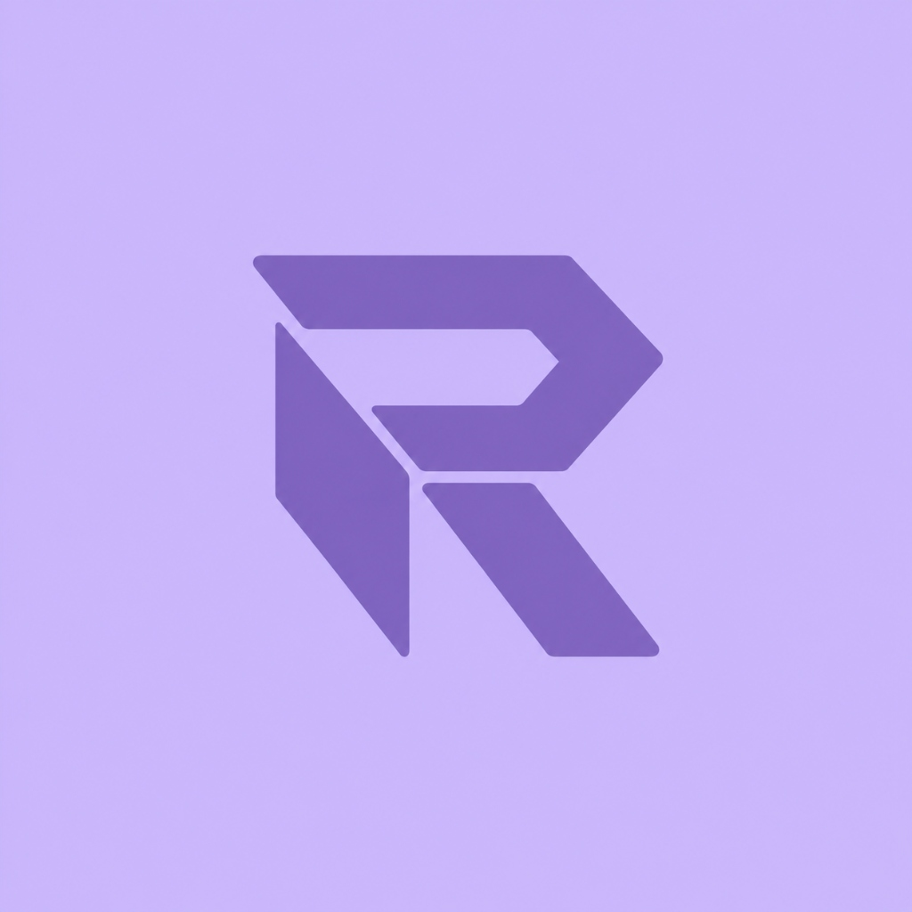
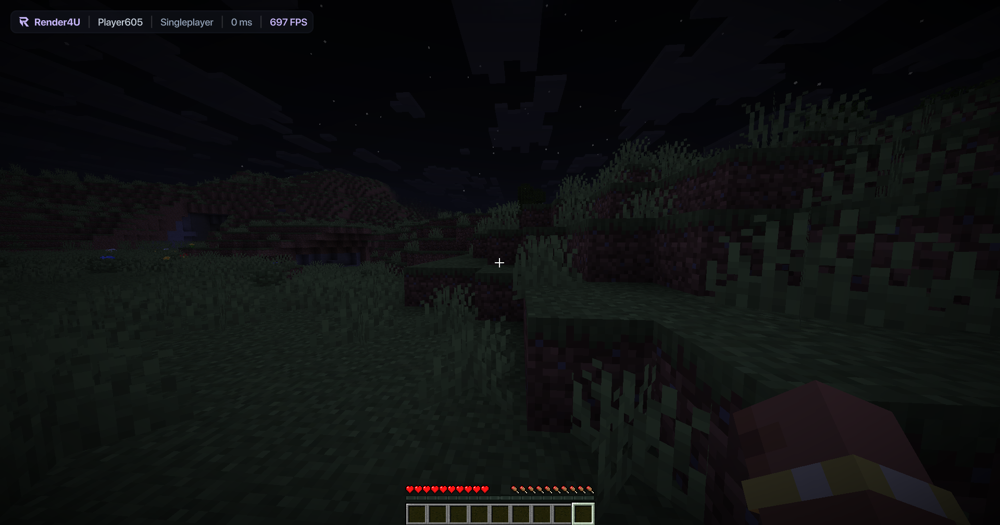
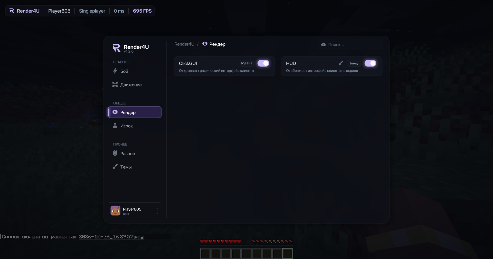
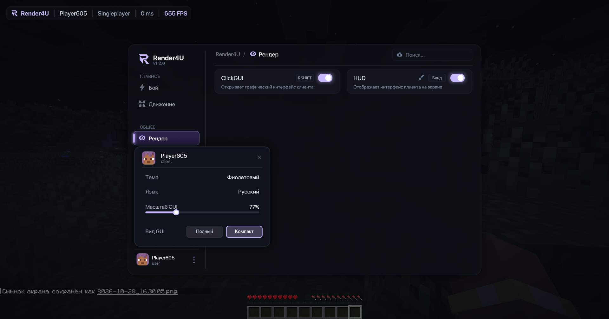
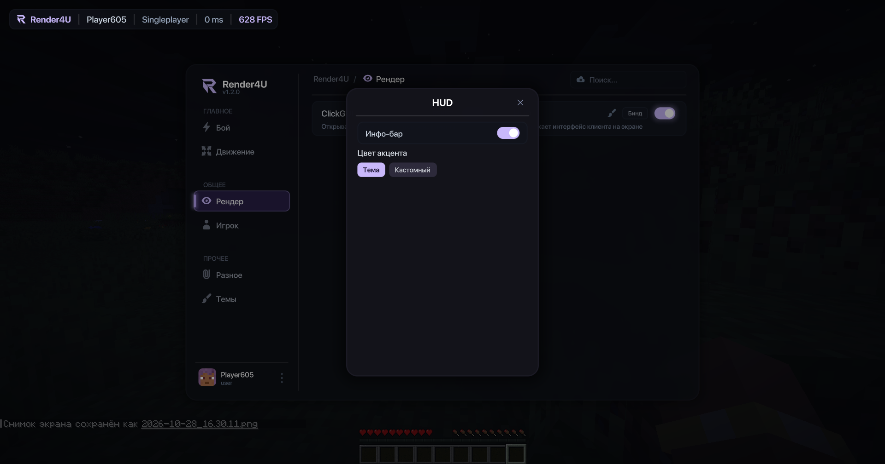

# Render4U

<p align="center">
  
</p>

<p align="center">
  <strong>Современная модульная клиентская база и рендер-движок нового поколения для Minecraft Fabric (26.3)</strong>
  <br />
  <em>Полноценная поддержка Vulkan & OpenGL | Шейдерный SDF-рендеринг | MSDF & TTF шрифты | ClickGUI с физическими анимациями</em>
</p>

<p align="center">
  
  
  
  
  
</p>

---

## Оглавление

- [Обзор](#обзор)
- [Ключевые возможности](#ключевые-возможности)
- [Встроенные модули](#встроенные-модули)
- [ClickGUI и управление](#clickgui-и-управление)
- [Темы оформления](#темы-оформления)
- [Рендер-движок и шейдерная архитектура](#рендер-движок-и-шейдерная-архитектура)
- [Руководство по API (Примеры кода)](#руководство-по-api-примеры-кода)
  - [1. Создание кастомного модуля](#1-создание-кастомного-модуля)
  - [2. Использование системы настроек (Settings)](#2-использование-системы-настроек-settings)
  - [3. Подписка на события (EventBus)](#3-подписка-на-события-eventbus)
  - [4. Отрисовка элементов интерфейса (Draw API)](#4-отрисовка-элементов-интерфейса-draw-api)
  - [5. Отрисовка в трехмерном мире (Render3D)](#5-отрисовка-в-трехмерном-мире-render3d)
  - [6. Анимации и цветовые градиенты](#6-анимации-и-цветовые-градиенты)
- [Структура проекта](#структура-проекта)
- [Сборка и запуск](#сборка-и-запуск)
- [Система конфигурации](#система-конфигурации)
- [Контакты и лицензия](#контакты-и-лицензия)

---

## Обзор

**Render4U** — это высокотехнологичная основа для создания современных модификаций и клиентов Minecraft на платформе Fabric 26.3. Проект спроектирован с упором на производительность, чистую архитектуру и визуальное качество.

В основе графической части лежит собственный конвейер SDF-шейдеров (Signed Distance Field) и двухпроходное размытие (Gaussian Blur), оптимизированные как под стандартный пайплайн **OpenGL**, так и под современный бэкенд **Vulkan**.

---

## Ключевые возможности

### Графический интерфейс (ClickGUI)
- **Плавные анимации**: интерполяция масштаба, альфа-канала и смещения элементов на основе физических пружин (`SpringAnimation`) и функций плавности (`Easing`).
- **Два режима отображения**:
  - `Full` — информативные карточки модулей с превью активных настроек (пиллами параметров).
  - `Compact` — компактный список для быстрого доступа и навигации.
- **Интерактивные элементы**: модальные панели настроек для каждого модуля, привязка клавиш на лету (биндинг) с анимацией ожидания, быстрый поиск модулей и сохранение состояния категорий.
- **Поддержка ввода**: полная совместимость с системой ввода мыши SDL и GLFW (ЛКМ, ПКМ, колесо прокрутки).
- **Масштабирование UI**: поддержка свободного изменения масштаба интерфейса от `50%` до `150%` (`uiScale: 0.5 – 1.5`, по умолчанию `85%`).
- **Мультиязычность**: встроенная система локализации (Русский / English) с автоматической синхронизацией языка игры.

### Высокопроизводительный рендер-движок
- **16 специализированных шейдерных конвейеров (`Pipelines`)**: отрисовка скругленных прямоугольников со сглаживанием субпикселей, контуров, теней, кругов, линий, голов игроков, текстур и размытия.
- **SDF-рендеринг**: безупречная четкость геометрии при любых углах и коэффициентах масштабирования.
- **Многопроходное размытие (Blur)**: фоновое размытие панелей по алгоритмам Гаусса с поддержкой отсечения (`scissor`) и регулируемой интенсивностью.
- **Система шрифтов MSDF & TTF**:
  - MSDF (Multi-channel Signed Distance Field): шрифты семейств SF Pro (Medium, Semibold, Bold), Roboto, векторные наборы иконок и логотипов с эффектами свечения (`glow`), обводки и градиентов.
  - TTF: нативная поддержка векторных TrueType-шрифтов через `TTFFontManager`.
- **Поддержка текстур и GIF**: декодирование и рендеринг анимированных GIF-файлов (`GifDecoder`, `GifTexture`) и скинов игроков со слоем шапки/брони.

### 3D-рендеринг в мировых координатах (Render3D)
- Проецирование трехмерных мировых координат в двухмерные экранные координаты с учетом матрицы вида и проекции камеры.
- Отрисовка трассеров к сущностям и координатам (`drawTracer`, `draw2DLine`).
- Отрисовка 3D-боксов и каркасных кубов (`draw3DBox`, `draw3DBoxBySize`).
- 2D-ограничивающие рамки и угловые боксы сущностей (`drawBox2D`, `drawCornerBox2D`).
- Проецирование произвольных интерфейсных компонентов (`DrawRect`) над точками в трехмерном мире (`draw2DElement`).

### Модульная архитектура и EventBus
- Быстрый диспетчер событий на базе аннотаций `@EventTarget` и низкоуровневых `MethodHandle`.
- Поддержка приоритетов выполнения: `HIGHEST (0)` -> `HIGH (1)` -> `MEDIUM (2)` -> `LOW (3)` -> `LOWEST (4)`.
- Система событий (полноценный набор для клиентской базы):
  - `EventTick` — игровой тик клиента;
  - `EventKey` — перехват и отмена клавиатурного ввода;
  - `EventChar` — перехват ввода символов (для поиска, чата и текстовых полей);
  - `EventMouseButton` — нажатия и отпускания кнопок мыши с экранными координатами курсора;
  - `EventMouseScroll` — прокрутка колёсика мыши (scrollX, scrollY);
  - `EventPacket` — перехват сетевых пакетов на отправку и приём (`isSend()`, `isReceive()`, `getPacket()`, отмена `cancel()`);
  - `EventInput` — перехват и изменение физического ввода движения игрока (WASD, прыжок, приседание, спринт, векторы импульсов);
  - `EventDisplay` — 2D-рендеринг оверлея и HUD;
  - `EventRender3D` — рендеринг в трехмерном пространстве мира.

### Совместимость с Vulkan и модами оптимизации
- Встроенный класс `VulkanHelper` определяет активный графический бэкенд и безопасно координирует команды рендера перед сбросом кэша конвейеров.
- Полная совместимость со стеком модов оптимизации Fabric: **Sodium**, **Lithium**, **ImmediatelyFast**, **C2ME**, **MoreCulling**, **Dynamic FPS** и др.

---

## Встроенные модули

Render4U поставляется с базовым набором предустановленных модулей:

| Модуль | Категория | Бинд по умолчанию | Статус по умолчанию | Описание | Настройки |
|---|---|:---:|:---:|---|---|
| **ClickGUI** | `RENDER` | `Right Shift` | Выключен | Открывает анимированный графический интерфейс клиента со списком категорий, модулей и настроек. | Нет |
| **HUD** | `RENDER` | `None` | **Включен** | Отображает на экране современный оверлей: верхний информационный бар с логотипом, именем игрока, сервером, пингом и FPS. | - **Инфо-бар** (`Boolean`)<br />- **Цвет акцента** (`Mode`: Тема / Кастомный)<br />- **Кастомный цвет** (`Color`)<br />- **FPS** (`Boolean`)<br />- **Пинг** (`Boolean`)<br />- **Сервер** (`Boolean`) |
| **AutoSprint** | `MOVEMENT` | `V` | Выключен | Автоматически активирует спринт при движении вперед (с проверкой уровня голода и препятствий). | Нет |

> **Примечание**: Категории `COMBAT`, `PLAYER` и `MISC` зарезервированы как готовые контейнеры для добавления новых модулей.

---

## ClickGUI и управление

| Действие | Управление |
|---|---|
| **Открыть / Закрыть GUI** | `Right Shift` или `ESC` |
| **Включить / Выключить модуль** | `ЛКМ` по карточке модуля или тумблеру |
| **Открыть панель настроек модуля** | `ПКМ` по карточке модуля или кнопка шестеренки |
| **Назначить клавишу (Бинд)** | `ЛКМ` по кнопке бинда -> нажать желаемую клавишу |
| **Сбросить бинд** | `ПКМ` по кнопке бинда (или `ESC` / `Delete` / `Backspace` во время ожидания ввода) |
| **Поиск модулей** | Клик по строке поиска вверху панели или шорткат `Ctrl + F` |
| **Настройки интерфейса (Меню)** | Кнопка троеточия в левом нижнем углу карточки игрока |
| **Быстрое переключение темы** | Клик по плашке темы в меню профиля |
| **Смена языка интерфейса** | Клик по плашке языка в меню профиля |
| **Прокрутка списков и настроек** | Колесико мыши (`Scroll`) |

### Скриншоты

<p align="center">
  
  
</p>
<p align="center">
  
  
</p>

---

## Темы оформления

Клиент поддерживает 6 готовых двухцветных градиентных палитр. Выбранная тема применяется ко всем элементам акцентного интерфейса и сохраняется в конфигурации:

| Тема | Название палитры | Цвета градиента | HEX-коды |
|---|---|---|---|
| **Фиолетовый** (По умолчанию) | Lavender / Purple | Lavender -> Purple | `#C9B8FB` - `#8B5CF6` |
| **Сапфир** | Sapphire | Light Blue -> Deep Blue | `#60A5FA` - `#2563EB` |
| **Изумруд** | Emerald | Mint -> Emerald | `#34D399` - `#059669` |
| **Закат** | Sunset | Coral Orange -> Deep Orange | `#FB923C` - `#EA580C` |
| **Рубин** | Ruby / Crimson | Rose -> Crimson Red | `#F87171` - `#DC2626` |
| **Неон** | Neon / Cyan | Electric Cyan -> Teal | `#22D3EE` - `#0891B2` |

---

## Рендер-движок и шейдерная архитектура

Рендеринг построен на статических фасадах `Draw` (2D) и `Render3D` (3D), взаимодействующих с `DisplayBatcher` и `Pipelines`.

### Список активных шейдерных конвейеров:
- **`ROUNDED_RECT`** — SDF прямоугольники с произвольным радиусом каждого угла и заливкой (сплошной, градиентной).
- **`OUTLINE`** — независимые контуры для каждой стороны с градиентными переходами.
- **`SHADOW`** — физически корректные мягкие тени и неоновое свечение (`glow`).
- **`BLUR_PANEL` / `BLUR_GAUSSIAN` / `BLUR_DOWNSAMPLE` / `BLUR_UPSAMPLE`** — многопроходная система размытия фона.
- **`CIRCLE` / `LINE`** — сглаженные векторные круги, кольца, дуги и линии.
- **`TEXT` / `FONT`** — конвейеры векторных глифов MSDF и растровых шрифтов.
- **`IMAGE` / `HEAD`** — текстурирование элементов со скруглением и наложением скинов игроков.

---

## Руководство по API (Примеры кода)

### 1. Создание кастомного модуля

Для создания нового модуля унаследуйте класс `Module` и зарегистрируйте его в `ModuleManager`:

```java
package dev.render4u.module.impl.render;

import com.mojang.blaze3d.platform.InputConstants;
import dev.render4u.core.event.EventTarget;
import dev.render4u.core.event.Priority;
import dev.render4u.core.event.impl.EventTick;
import dev.render4u.module.Category;
import dev.render4u.module.Module;
import dev.render4u.module.setting.BooleanSetting;
import dev.render4u.module.setting.NumberSetting;

public class CustomESP extends Module {
    public final BooleanSetting showBoxes = new BooleanSetting("Боксы", true, "Отображать 2D рамки вокруг целей");
    public final NumberSetting range = new NumberSetting("Дистанция", 16.0, 4.0, 64.0, 1.0, 0, "m", "Радиус поиска");

    public CustomESP() {
        super("CustomESP", "Отображает игроков и мобов сквозь препятствия", Category.RENDER, InputConstants.KEY_X);
        addSettings(showBoxes, range);
    }

    @Override
    public void onEnable() {
    }

    @Override
    public void onDisable() {
    }

    @EventTarget(Priority.HIGH)
    public void onTick(EventTick event) {
        if (!isEnabled() || mc.player == null) return;
    }
}
```

### 2. Использование системы настроек (Settings)

Библиотека поддерживает 7 типов настроек с гибким контролем видимости:

```java
// 1. Логический флаг
BooleanSetting flag = new BooleanSetting("Трассеры", true, "Отрисовка линий к сущностям");

// 2. Числовой слайдер (имя, значение, мин, макс, шаг, точность, ед. изм., описание)
NumberSetting slider = new NumberSetting("Толщина", 2.0, 0.5, 5.0, 0.5, 1, "px", "Толщина контура");

// 3. Выбор одного режима
ModeSetting mode = new ModeSetting("Режим", "2D", List.of("2D", "3D", "Угловой"), "Тип отображения");

// 4. Множественный выбор (MultiMode)
MultiModeSetting targets = new MultiModeSetting("Цели", Set.of("Игроки"), List.of("Игроки", "Мобы", "Предметы"), "Фильтр объектов");

// 5. Цвет (RGB/HEX с поддержкой прозрачности и условием показа)
ColorSetting color = new ColorSetting("Цвет бокса", 0xFF38BDF8, true, "Основной цвет обводки", () -> mode.is("2D"));

// 6. Назначение клавиши
KeybindSetting key = new KeybindSetting("Быстрая клавиша", InputConstants.KEY_G, "Активация альтернативного режима");

// 7. Текстовое поле
StringSetting text = new StringSetting("Префикс", "[Render4U]", 32, "Префикс в чате");
```

### 3. Подписка на события (EventBus)

```java
Render4U.getEventBus().register(new Object() {
    @EventTarget(Priority.HIGHEST)
    public void onKey(EventKey event) {
        if (event.isPressed() && event.getKey() == InputConstants.KEY_K) {
            // Обработка нажатия клавиши
        }
    }

    @EventTarget
    public void onPacket(EventPacket event) {
        if (event.isSend()) {
            // Анализ или отмена отправляемых пакетов
        } else if (event.isReceive()) {
            // Обработка входящих сетевых пакетов
        }
    }

    @EventTarget
    public void onInput(EventInput event) {
        // Модификация движения игрока
    }

    @EventTarget
    public void onMouseButton(EventMouseButton event) {
        if (event.isPressed()) {
            // Обработка клика мыши
        }
    }

    @EventTarget
    public void onDisplay(EventDisplay event) {
        GuiGraphicsExtractor graphics = event.graphics();
        Draw.text(graphics, MsdfFonts.SF_BOLD, "Hello World", 20, 20, 14.0F, 0xFFFFFFFF);
    }

    @EventTarget
    public void onRender3D(EventRender3D event) {
        // Отрисовка в трехмерном мире
    }
});
```

### 4. Отрисовка элементов интерфейса (Draw API)

```java
DrawRect panel = DrawRect.create()
        .bounds(x, y, 280.0F, 120.0F)
        .bg(0xEE111827)
        .blur(4)
        .rounding(10.0F)
        .outline(1.0F, 0x33FFFFFF)
        .shadow(14.0F, 0.0F, 6.0F, 0x88000000);

panel.render(graphics);

Draw.textWithGlow(graphics, MsdfFonts.SF_BOLD, "Render4U Client", x + 16, y + 16, 15.0F, 0xFFFFFFFF, 0x88A855F7, 0.4F);
Draw.headSelf(graphics, x + 16, y + 42, 32.0F, 8.0F, 1.0F);
```

### 5. Отрисовка в трехмерном мире (Render3D)

```java
Render3D.drawTracer(graphics, targetX, targetY, targetZ, 0xFF38BDF8, 1.5F);
Render3D.drawBox2D(graphics, entity.getBoundingBox(), 0xFF22C55E, 1.5F);
Render3D.draw3DBoxBySize(graphics, targetX, targetY, targetZ, 1.0, 2.0, 1.0, 0x55818CF8, 1.5F);
Render3D.drawNametag(graphics, targetX, targetY + 2.2, targetZ, "Enemy [100 HP]", 0xFFEF4444, 0xAA000000);
```

### 6. Анимации и цветовые градиенты

```java
SpringAnimation scaleAnim = new SpringAnimation(1.0F, 220.0F, 16.0F);
scaleAnim.target(1.2F);
float currentScale = scaleAnim.update();

float progress = Easing.EASE_OUT_CUBIC.ease(animationTime);

Gradient rainbow = Gradient.RAINBOW.angle(45.0F);
int sampledColor = rainbow.sample(0.75F);

int blended = BlendMode.OVERLAY.blend(0xFF1E293B, 0xFF38BDF8);
```

---

## Структура проекта

```
dev/render4u/
├── Constants.java               # Метаданные клиента (геттеры modId, name, version)
├── Render4U.java                # Главный входной класс инициализации мода
├── config/                      # Менеджер сохранения и загрузки конфигурации (JSON)
├── core/event/                  # Событийная шина (EventBus, Priority, EventTarget)
│   └── impl/                    # События (Packet, Input, Key, Mouse, Char, Tick, Display, Render3D)
├── gui/                         # Интерфейс ClickGUI (экраны, карточки, боковая панель)
│   └── impl/                    # Рендеры карточек, боковой панели, попапа профиля и настроек
├── mixin/                       # Миксины (Connection, Input, Mouse, Keyboard, Minecraft, Window, Render)
├── module/                      # Модульная система, категории, типы настроек
│   ├── impl/                    # Реализации модулей (AutoSprint, ClickGui, HUD)
│   └── setting/                 # Настройки (Boolean, Number, Mode, MultiMode, Color, Keybind, String)
├── render/                      # Графический рендер-движок
│   ├── display/                 # 2D Draw API, шейдерные конвейеры (Pipelines), размытие
│   ├── font/                    # Движки шрифтов MSDF и TTF
│   ├── vulkan/                  # Адаптер совместимости и детекции Vulkan
│   └── world/                   # 3D Render API (проекции матриц, трассеры, боксы)
├── theme/                       # Менеджер тем оформления интерфейса
└── util/                        # Анимации, цвета, градиенты, локализация (Lang), KeyUtil
```

---

## Сборка и запуск

### Требования
- **JDK 25** или новее.
- Установленный **Git**.

### Сборка JAR-файла
```bash
git clone https://github.com/Sanderovich2/Render4U.git
cd Render4U
./gradlew build
```
Готовый JAR-файл будет помещен в папку `build/libs/render4u-1.3.0.jar`.

### Запуск в среде разработки

Запуск клиента со стандартным бэкендом (OpenGL):
```bash
./gradlew runClient
```

Запуск клиента с бэкендом **Vulkan**:
```bash
./gradlew runClientVulkan
```

---

## Система конфигурации

Все параметры сохраняются автоматически при закрытии игры, а также в реальном времени при изменении в файл:
```
.minecraft/render4u/config.json
```

Для защиты от повреждения данных при внезапном завершении процесса используется **атомарная запись** (через временный файл и `StandardCopyOption.ATOMIC_MOVE`).

### Пример структуры `config.json`:
```json
{
  "uiScale": 0.85,
  "compact": false,
  "theme": "purple",
  "language": "RU",
  "modules": {
    "AutoSprint": {
      "enabled": false,
      "key": 86,
      "settings": {}
    },
    "ClickGUI": {
      "enabled": false,
      "key": 344,
      "settings": {}
    },
    "HUD": {
      "enabled": true,
      "key": 0,
      "settings": {
        "Инфо-бар": true,
        "Цвет акцента": "Тема",
        "Кастомный цвет": -3557125,
        "FPS": true,
        "Пинг": true,
        "Сервер": true
      }
    }
  }
}
```

---

## Контакты и лицензия

- **Репозиторий проекта**: [GitHub — Sanderovich2/Render4U](https://github.com/Sanderovich2/Render4U)
- **Связь с разработчиком**: [Telegram — @wtfcrunk](https://t.me/wtfcrunk)

Проект лицензирован под условиями [MIT License](LICENSE). Вы можете свободно модифицировать, распространять и использовать этот код в личных и коммерческих проектах.
